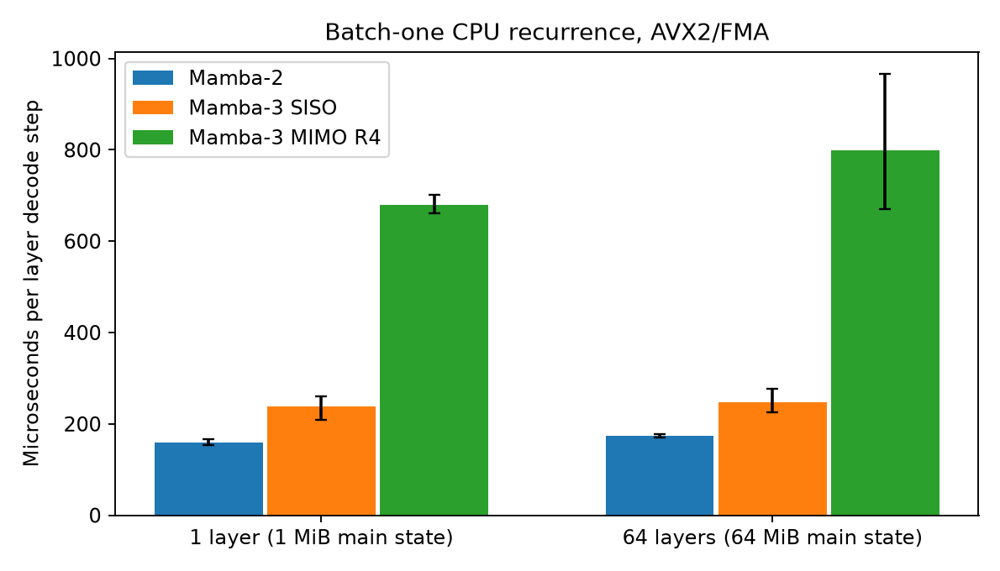

# What rank-4 MIMO costs on this CPU

On a single performance core of the Intel Core Ultra 9 185H, Mamba-3 rank-4 MIMO took **2.85× as long as SISO** with a repeatedly reused 1 MiB state (680 versus 239 µs per layer step). Cycling through 64 layers, whose recurrent matrices alone exceed the 24 MiB last-level cache, gave **3.24×** (799 versus 247 µs). Both variants carry the same 1 MiB recurrent matrix per layer. MIMO raises the estimated dominant arithmetic intensity from 1.07 to 2.98 FLOP per logical byte, and its auxiliary carry rises from 18 to 42 KiB per layer. At these shapes the extra rank work has a substantial latency cost in both regimes. These synthetic operator runs measure latency; they do not evaluate model quality.

## Native timings

Mean microseconds per layer step with observed minimum–maximum in parentheses. Each cell summarizes three repeats. Each case runs batch one with 16 heads, 128 channels/head and 128 state coordinates.

| Working set | Kernel | Plain C++ | AVX2/FMA |
|---|---|---:|---:|
| One layer | Mamba-2 | 665 (573–798) | 159 (153–167) |
| One layer | Mamba-3 SISO | 782 (728–866) | 239 (208–261) |
| One layer | Mamba-3 MIMO, rank 4 | 1,786 (1,774–1,794) | 680 (662–702) |
| 64 layers | Mamba-2 | 609 (573–673) | 173 (170–177) |
| 64 layers | Mamba-3 SISO | 735 (698–756) | 247 (226–276) |
| 64 layers | Mamba-3 MIMO, rank 4 | 1,910 (1,804–2,007) | 799 (670–966) |

The laptop was on AC power with the benchmark pinned to logical CPU 0. The 64-layer MIMO timings show the widest spread. The SISO and MIMO timing ranges are disjoint within each working set, but three repeats give limited precision for comparing the two slowdown ratios. Actual cache misses and DRAM traffic were not sampled. Mamba-2 has the lowest dominant arithmetic intensity at 0.61 FLOP per logical byte.

## Validation

All 18 reference cases completed 1,000 consecutive steps each. The largest absolute Mamba-3 output error was 4.25e-7 for SISO and 6.82e-8 for rank four. Across the carried-state tensors the worst absolute error was 5.73e-6, below the absolute tolerance of 2e-5. Both rank-reduction tests passed. Both ggml graph checks produced exactly the direct native results across 1,000 steps.

